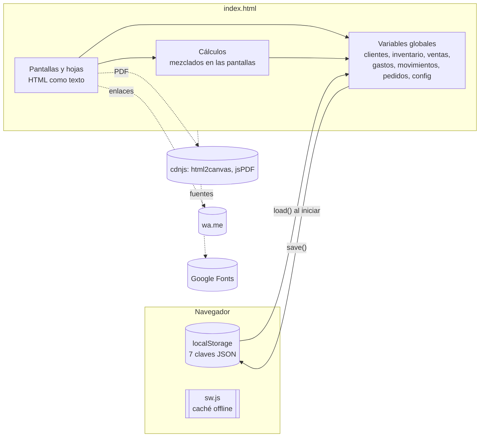
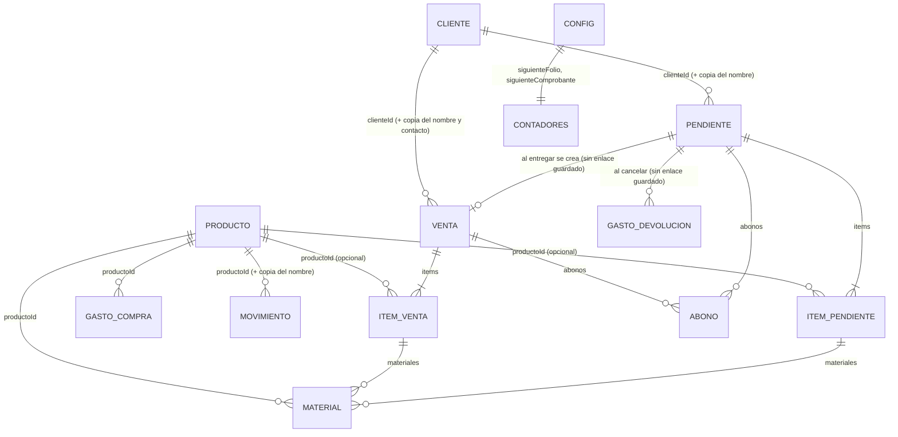

# Orisma 2.0 · Etapa 1 · Documento 3
# Mapa de dependencias y relaciones

**Versión auditada:** commit `9300dfa`, `index.html`. `L123` = línea del archivo.

## 1. Arquitectura actual en una frase

Todo el JavaScript vive dentro de **una sola función anónima** (L450–4138) que comparte siete variables globales
de datos. Cada pantalla es una función que arma HTML como texto, lo inserta con `innerHTML` y engancha sus
botones. No hay capas: la misma función calcula, valida, guarda en `localStorage` y redibuja.

## 2. Relaciones entre datos

Características de estas relaciones:

- **No hay integridad referencial.** Los enlaces son ids sueltos. Borrar un cliente o un producto deja ventas,
  pendientes, compras y movimientos apuntando a un id que ya no existe (probado en T5).
- **Copias desnormalizadas.** Ventas y pendientes guardan copia del nombre del cliente; movimientos y materiales
  guardan copia del nombre del producto. Es intencional (la factura conserva los datos del momento) pero no está
  documentado y cambiar el nombre del cliente no actualiza ventas anteriores.
- **Relaciones implícitas sin rastro.** Una venta que vino de un pedido no guarda de qué pedido vino; una
  devolución por cancelación no guarda a qué pedido corresponde. Solo se pueden relacionar por cliente y fecha.
- **Agrupaciones por nombre.** El "Top 5" agrupa por nombre del producto, no por id (RR-04).
- **Abonos duplicados al entregar.** Al entregar un pendiente, sus abonos se copian a la venta y el pendiente
  queda "entregado"; la caja evita contarlos dos veces ignorando los abonos de pendientes entregados (RK-03).

## 3. Qué escribe cada operación

Operaciones que modifican varios conjuntos de datos a la vez. Hoy cada conjunto se guarda por separado,
uno tras otro, **sin transacción**: si falla el segundo guardado (por ejemplo, almacenamiento lleno) los datos
quedan a medias (D4-10).

| Operación | clientes | inventario | ventas | gastos | movimientos | pedidos | config |
|---|:-:|:-:|:-:|:-:|:-:|:-:|:-:|
| Crear / editar / eliminar cliente | ✎ | | | | | | |
| Crear producto | | ✎ | | | ✎ alta | | |
| Editar producto (con cambio de stock) | | ✎ | | | ✎ ajuste | | |
| Eliminar producto | | ✎ | | | ✎ baja | | |
| Compra desde el producto | | ✎ stock, costo, precio | | ✎ (sin tipo) | | | |
| Compra desde Gastos | | ✎ (o crea) | | ✎ compra | ✎ alta si es nuevo | | |
| Gasto general (crear/editar/eliminar) | | | | ✎ | | | |
| Venta (asistente) | | ✎ stock | ✎ | | | | |
| Pedido/encargo/apartado (crear/editar) | | | | | | ✎ | |
| Abono a pendiente | | | | | | ✎ | |
| Entregar pendiente | | ✎ stock | ✎ nueva venta | | | ✎ estado | |
| Cancelar pendiente | | | | ✎ devolución | | ✎ estado | |
| Comprobante de abono (abrir) | | | | | | | ✎ contador |
| Abono / liquidación de crédito | | | ✎ | | | | |
| Generar factura | | | ✎ folio | | | | ✎ contador |
| Editar factura | | | ✎ | | | | |
| Anular venta / factura | | ✎ stock | ✎ borra | | ✎ devolución | | |
| Ajustes (cualquier sección) | | | | | | | ✎ |
| Restaurar respaldo | ✎ | ✎ | ✎ | ✎ | ✎ | ✎ | ✎ (mezcla) |

## 4. Qué lee cada pantalla

| Pantalla | Lee |
|---|---|
| Clientes (lista) | clientes, ventas (saldo de cada cliente) |
| Inventario › Productos | inventario, pedidos (reservas), config (límite de poco stock) |
| Inventario › Stock | inventario, pedidos |
| Inventario › Historial | ventas, gastos, movimientos, inventario |
| Ventas › Ventas | ventas |
| Ventas › Pendientes | pedidos, config (impuesto, para apartados) |
| Facturas | ventas |
| Gastos | gastos |
| Reportes › Resumen | ventas, gastos, inventario, pedidos, config |
| Reportes › Caja | ventas, pedidos, gastos |
| Reportes › Flujo | ventas, pedidos, gastos |
| Factura (documento) | venta, inventario (descripción y foto), config (todo el diseño) |
| Asistente de venta | clientes, inventario, pedidos (disponible), config (impuesto) |

## 5. Dependencias externas

| Dependencia | Para qué | Cómo se carga | Sin internet | Riesgo |
|---|---|---|---|---|
| Google Fonts (Inter, IBM Plex Mono) | tipografía | `<link>` en el `<head>` | usa fuentes del sistema (si no quedaron en caché) | bajo |
| html2canvas 1.4.1 | convertir la factura en imagen | `<script>` creado al compartir PDF, desde cdnjs | **falla** (T15) | medio: sin verificación de integridad (SRI) |
| jsPDF 2.5.1 | armar el PDF | igual | **falla** (T15) | medio |
| wa.me | abrir WhatsApp con texto | `window.open` | no aplica | bajo |
| Contact Picker API | importar contactos | API del navegador (solo Chrome Android) | funciona | ninguno |
| Web Share API | compartir el PDF | API del navegador | funciona | ninguno |
| `window.claude.use('downloads')` | guardar archivos dentro del entorno de artifacts de Claude | se usa solo si existe | — | resto del entorno donde se creó la app; fuera de él no hace nada |

No hay `package.json`, ni compilación, ni otras librerías.

## 6. Almacenamiento y archivos

| Aspecto | Situación actual |
|---|---|
| Motor | `localStorage` (límite real medido en Chromium: ~5,2 millones de caracteres por origen, T7) |
| Escritura | cada `save()` reescribe la colección **completa** en JSON |
| Errores | `save()` captura el error y solo escribe en la consola; el usuario no se entera (T7) |
| Imágenes | en base64 dentro de los mismos JSON: foto de producto (300 px), foto de ítems de servicio/prenda (300 px, **copiada dentro de cada venta y pendiente**), logo y foto de perfil (400 px), firma (PNG del tamaño del recuadro) |
| Versión de datos | no hay número de versión ni migraciones; los formatos viejos se toleran con `||` y valores por defecto repartidos por el código |
| Respaldo | archivo JSON manual (Ajustes › Respaldo); sin respaldo automático ni antes de restaurar |

## 7. Funcionamiento sin conexión (sw.js)

| Aspecto | Situación actual |
|---|---|
| Estrategia | primero la red; si falla, la copia en caché; si no hay copia, **devuelve `index.html` para cualquier petición** |
| Precarga | `./`, `index.html`, `manifest.json`, `icon-192.png`, `icon-512.png` (no `apple-touch-icon.png`) |
| Versión | constante `CACHE = "cuentas-v3"` que hay que cambiar a mano |
| Efecto secundario | al pedir html2canvas sin conexión, el SW responde con `index.html`; el navegador lo trata como script, no falla la carga y el error que ve el usuario es "window.html2canvas is not a function" (T15) |
| Caché de terceros | guarda también fuentes y librerías de CDN si alguna vez se cargaron con conexión |

## 8. Funciones más usadas (puntos de acoplamiento)

Calculado automáticamente (`pruebas/graph.js`). Número de funciones distintas que llaman a cada una:

| Función | Llamada desde | Papel |
|---|---|---|
| `escapeHtml` | 37 | protección al insertar texto en HTML |
| `money` | 34 | formato de dinero (depende de `config.moneda`) |
| `openOverlay` | 27 | todas las hojas emergentes |
| `todayStr` | 22 | fecha de hoy |
| `fmtDate` | 21 | formato de fecha |
| `save` | 21 | guardado |
| `renderList` | 17 | redibujar la pestaña actual tras cualquier cambio |
| `segHtml` | 13 | selector segmentado |
| `uid` | 13 | identificadores |
| `saldoVenta` | 10 | saldo de una venta |
| `emptyState` | 10 | estado vacío |

## 9. Código duplicado detectado

| Cálculo | Veces | Dónde |
|---|---|---|
| Total de un pendiente (con 3 fórmulas distintas, ver D4-02) | 8 | L961, L1072–1078, L1179–1184, L1282, L1309, L1353, L1422, L1747 |
| Costo promedio ponderado + sincronizar precio/ganancia | 3 copias casi idénticas | `openCompraForm` L2205–2241, compra en Gastos L2461–2490, guardado L2559–2563 |
| Reservas de un producto (mismo bucle) | 2 | `reservadoSinEncargos` L850 y `unidadesReservadas` L878 |
| "Abonos o anticipo como abono" | 4 | L1267, L1311, L1623, L1668 |
| Devolver stock / descontar stock de productos y materiales | 3 | L1165–1219, L3155–3163, L3649–3662 |
| `stock === '' \|\| stock === null` (¿tiene control?) | 12 líneas | por todo el archivo |
| Folio con 4 dígitos `String(folio).padStart(4,'0')` | 12 líneas | por todo el archivo |
| Selector efectivo/tarjeta con su lógica de clic | 11 | abonos, gastos, pendientes, liquidación… |
| Generar y descargar archivo (enlace + `window.claude`) | 2 | L3456, L3805–3826 |

## 10. Anexo: grafo completo de funciones

Para cada función de nivel superior: qué otras funciones llama, qué datos lee y en qué claves de `localStorage` escribe.
Generado con `pruebas/graph.js` sobre el `index.html` original. Las funciones internas de los formularios grandes
(asistente de venta, gastos) se cuentan dentro de su función contenedora.

Total de funciones de nivel superior: 98. Variables de nivel superior: 27.

#### Datos/Utilidades

| Función | Línea | Llama a | Lee datos | Escribe datos (localStorage) |
|---|---|---|---|---|
| `load` | 454 | — | — | — |
| `save` | 458 | — | — | — |
| `uid` | 493 | — | — | — |
| `money` | 494 | — | config | — |
| `escapeHtml` | 501 | — | — | — |
| `initials` | 504 | — | — | — |
| `todayStr` | 507 | — | — | — |
| `fmtDate` | 508 | — | — | — |
| `monthKey` | 512 | — | — | — |

#### Núcleo/Navegación

| Función | Línea | Llama a | Lee datos | Escribe datos (localStorage) |
|---|---|---|---|---|
| `renderHeader` | 517 | `escapeHtml`, `initials` | config | — |
| `emptyState` | 530 | `escapeHtml` | — | — |
| `renderList` | 537 | `renderClientes`, `renderFacturas`, `renderGastos`, `renderInventario`, `renderReportes`, `renderVentas` | — | — |

#### Créditos

| Función | Línea | Llama a | Lee datos | Escribe datos (localStorage) |
|---|---|---|---|---|
| `metodoLabel` | 550 | — | — | — |
| `segHtml` | 551 | — | — | — |
| `abonadoVenta` | 555 | — | — | — |
| `saldoVenta` | 556 | `abonadoVenta` | — | — |
| `clienteSaldo` | 557 | `saldoVenta` | ventas | — |
| `openAbonoForm` | 559 | `abonadoVenta`, `escapeHtml`, `fmtDate`, `money`, `openClienteForm`, `openOverlay`, `renderList`, `saldoVenta`, `save`, `segHtml`, `todayStr`, `uid` | config, ventas | ventas |

#### Clientes

| Función | Línea | Llama a | Lee datos | Escribe datos (localStorage) |
|---|---|---|---|---|
| `renderClientes` | 624 | `clienteSaldo`, `emptyState`, `escapeHtml`, `money`, `openClienteForm` | clientes | — |

#### Inventario

| Función | Línea | Llama a | Lee datos | Escribe datos (localStorage) |
|---|---|---|---|---|
| `getCategorias` | 645 | — | inventario | — |
| `bindInvSub` | 651 | `renderInventario` | — | — |
| `movimientosInventario` | 655 | `money` | gastos, inventario, movimientos, ventas | — |
| `renderHistorialHtml` | 681 | `emptyState`, `escapeHtml`, `fmtDate`, `movimientosInventario` | gastos, movimientos, ventas | — |
| `umbralStock` | 709 | — | config | — |
| `esPocoStock` | 714 | `umbralStock` | — | — |
| `bindPocoBanner` | 719 | `openPocoStock` | — | — |
| `openPocoStock` | 723 | `emptyState`, `esPocoStock`, `escapeHtml`, `openOverlay`, `openProductoForm`, `umbralStock` | inventario | — |
| `renderStockHtml` | 749 | `emptyState`, `esPocoStock`, `escapeHtml`, `money`, `unidadesReservadas` | inventario | — |
| `renderInventario` | 785 | `bindCatChips`, `bindInvSub`, `bindPocoBanner`, `emptyState`, `esPocoStock`, `escapeHtml`, `getCategorias`, `money`, `openProductoForm`, `renderHistorialHtml`, `renderStockHtml`, `segHtml`, `unidadesReservadas` | inventario | — |
| `bindCatChips` | 840 | `renderInventario` | — | — |

#### Pedidos/Apartados

| Función | Línea | Llama a | Lee datos | Escribe datos (localStorage) |
|---|---|---|---|---|
| `reservadoSinEncargos` | 850 | — | pedidos | — |
| `reservadoPorEncargos` | 861 | `reservadoSinEncargos` | inventario, pedidos | — |
| `unidadesReservadas` | 878 | `reservadoPorEncargos` | pedidos | — |
| `segVentas` | 889 | `segHtml` | — | — |
| `bindVentasSeg` | 892 | `renderVentas` | — | — |
| `pedidoEstadoInfo` | 896 | `fmtDate`, `todayStr` | — | — |
| `openNuevoPendiente` | 904 | `openOverlay`, `openPedidoForm` | — | — |
| `renderPedidosHtml` | 921 | `apartadoAbonado`, `apartadoTotal`, `emptyState`, `escapeHtml`, `money`, `pedidoEstadoInfo`, `todayStr` | pedidos | — |
| `openPedidoForm` | 995 | `escapeHtml`, `money`, `openOverlay`, `renderList`, `save`, `segHtml`, `todayStr`, `uid` | clientes, config, inventario, pedidos | pedidos |
| `costoPedido` | 1145 | — | inventario | — |
| `avisarPendienteWA` | 1152 | `fmtDate`, `money`, `waUrl` | clientes, config | — |
| `entregarPedido` | 1164 | `costoPedido`, `renderList`, `save`, `todayStr`, `uid` | clientes, config, inventario, pedidos, ventas | ventas, inventario, pedidos |
| `comprobanteDeAbono` | 1230 | `save`, `todayStr` | clientes, config | config |
| `openComprobante` | 1247 | `buildInvoiceHtml`, `compartirFacturaPDF`, `comprobanteDeAbono`, `openOverlay` | pedidos | — |
| `cancelarPedidoConEfecto` | 1266 | `escapeHtml`, `fmtDate`, `money`, `openOverlay`, `renderList`, `save`, `todayStr`, `uid` | gastos, pedidos | gastos, pedidos |
| `registrarAbonoPedido` | 1306 | `escapeHtml`, `money`, `openOverlay`, `openPedidoDetalle`, `renderList`, `save`, `segHtml`, `todayStr`, `uid` | config, pedidos | pedidos |
| `openPedidoDetalle` | 1350 | `avisarPendienteWA`, `cancelarPedidoConEfecto`, `costoPedido`, `entregarPedido`, `escapeHtml`, `fmtDate`, `money`, `openComprobante`, `openOverlay`, `openPedidoForm`, `pedidoEstadoInfo`, `registrarAbonoPedido`, `segHtml` | pedidos | — |
| `apartadoTotal` | 1422 | — | config | — |
| `apartadoAbonado` | 1426 | — | — | — |
| `renderApartadosHtml` | 1428 | `apartadoAbonado`, `apartadoTotal`, `emptyState`, `escapeHtml`, `fmtDate`, `money` | pedidos | — |
| `openApartadoDetalle` | 1459 | `apartadoAbonado`, `apartadoTotal`, `avisarPendienteWA`, `cancelarPedidoConEfecto`, `entregarPedido`, `escapeHtml`, `fmtDate`, `metodoLabel`, `money`, `openComprobante`, `openOverlay`, `openPedidoForm`, `renderList`, `save`, `segHtml`, `todayStr`, `uid` | config, pedidos | pedidos |

#### Ventas

| Función | Línea | Llama a | Lee datos | Escribe datos (localStorage) |
|---|---|---|---|---|
| `renderVentas` | 1535 | `bindVentasSeg`, `openApartadoDetalle`, `openPedidoDetalle`, `renderApartadosHtml`, `renderPedidosHtml`, `renderVentasLista`, `segVentas` | pedidos | — |
| `renderVentasLista` | 1553 | `emptyState`, `escapeHtml`, `fmtDate`, `metodoLabel`, `money`, `openVentaDetail` | ventas | — |

#### Gastos

| Función | Línea | Llama a | Lee datos | Escribe datos (localStorage) |
|---|---|---|---|---|
| `renderGastos` | 1576 | `emptyState`, `escapeHtml`, `fmtDate`, `money`, `openGastoForm` | gastos | — |

#### Reportes/Caja/Flujo

| Función | Línea | Llama a | Lee datos | Escribe datos (localStorage) |
|---|---|---|---|---|
| `cajaResumen` | 1608 | `todayStr` | gastos, pedidos, ventas | — |
| `renderCajaHtml` | 1645 | `cajaResumen`, `escapeHtml`, `fmtDate`, `money`, `monthKey`, `segHtml`, `todayStr` | gastos, pedidos, ventas | — |
| `renderFlujoHtml` | 1742 | `cajaResumen`, `money`, `monthKey`, `saldoVenta`, `segHtml` | gastos, pedidos, ventas | — |
| `bindVistaReportes` | 1788 | `renderReportes` | — | — |
| `mesAnteriorKey` | 1800 | `todayStr` | — | — |
| `gananciaDe` | 1804 | — | — | — |
| `renderReportes` | 1813 | `bindVistaReportes`, `esPocoStock`, `escapeHtml`, `gananciaDe`, `mesAnteriorKey`, `money`, `monthKey`, `renderCajaHtml`, `renderFlujoHtml`, `saldoVenta`, `segHtml`, `todayStr` | gastos, inventario, ventas | — |

#### UI (overlay)

| Función | Línea | Llama a | Lee datos | Escribe datos (localStorage) |
|---|---|---|---|---|
| `openOverlay` | 1910 | — | — | — |

#### Clientes

| Función | Línea | Llama a | Lee datos | Escribe datos (localStorage) |
|---|---|---|---|---|
| `puedeContactos` | 1924 | — | — | — |
| `openClienteForm` | 1927 | `abonadoVenta`, `escapeHtml`, `fmtDate`, `money`, `openAbonoForm`, `openOverlay`, `puedeContactos`, `renderList`, `saldoVenta`, `save`, `uid` | clientes, ventas | clientes |

#### Inventario

| Función | Línea | Llama a | Lee datos | Escribe datos (localStorage) |
|---|---|---|---|---|
| `openProductoForm` | 1997 | `escapeHtml`, `fmtDate`, `getCategorias`, `imagePickerHtml`, `money`, `openCompraForm`, `openOverlay`, `renderList`, `save`, `todayStr`, `toggleRowHtml`, `uid`, `wireImagePicker` | config, gastos, inventario, movimientos, ventas | movimientos, inventario |
| `openCompraForm` | 2172 | `escapeHtml`, `money`, `openOverlay`, `renderList`, `save`, `todayStr`, `uid` | config, gastos, inventario | inventario, gastos |

#### Gastos

| Función | Línea | Llama a | Lee datos | Escribe datos (localStorage) |
|---|---|---|---|---|
| `openGastoForm` | 2277 | `escapeHtml`, `money`, `openOverlay`, `renderList`, `save`, `segHtml`, `todayStr`, `uid` | config, gastos, inventario, movimientos | gastos, movimientos, inventario |

#### Venta (asistente)

| Función | Línea | Llama a | Lee datos | Escribe datos (localStorage) |
|---|---|---|---|---|
| `openVentaWizard` | 2587 | `escapeHtml`, `fmtDate`, `imagePickerHtml`, `money`, `openOverlay`, `openVentaSavedConfirm`, `renderList`, `save`, `segHtml`, `todayStr`, `uid`, `unidadesReservadas`, `wireImagePicker` | clientes, config, inventario, pedidos, ventas | pedidos, ventas, inventario |
| `openVentaSavedConfirm` | 3174 | `escapeHtml`, `fmtDate`, `generarFactura`, `money`, `openOverlay` | ventas | — |
| `generarFactura` | 3204 | `openVentaDetail`, `renderList`, `save` | config, ventas | ventas, config |

#### Facturas

| Función | Línea | Llama a | Lee datos | Escribe datos (localStorage) |
|---|---|---|---|---|
| `renderFacturas` | 3220 | `emptyState`, `escapeHtml`, `fmtDate`, `money`, `openVentaDetail` | ventas | — |
| `openSinFacturaPicker` | 3249 | `escapeHtml`, `fmtDate`, `generarFactura`, `money`, `openOverlay` | ventas | — |
| `buildInvoiceHtml` | 3279 | `abonadoVenta`, `escapeHtml`, `fmtDate`, `initials`, `metodoLabel`, `money`, `saldoVenta` | config, inventario | — |
| `buildVentaSummaryHtml` | 3374 | `escapeHtml`, `fmtDate`, `money` | — | — |
| `openVentaDetail` | 3397 | `anularVenta`, `buildInvoiceHtml`, `buildVentaSummaryHtml`, `compartirFacturaPDF`, `generarFactura`, `money`, `openFacturaEdit`, `openOverlay` | ventas | — |
| `cargarLibsPDF` | 3444 | — | — | — |
| `descargarArchivo` | 3456 | — | — | — |
| `compartirFacturaPDF` | 3467 | `buildInvoiceHtml`, `cargarLibsPDF`, `descargarArchivo`, `money`, `saldoVenta`, `waUrl` | clientes, config | — |
| `openFacturaEdit` | 3516 | `escapeHtml`, `openOverlay`, `openVentaDetail`, `renderList`, `save` | ventas | ventas |

#### UI (imágenes/toggles)

| Función | Línea | Llama a | Lee datos | Escribe datos (localStorage) |
|---|---|---|---|---|
| `resizeImageFile` | 3559 | — | — | — |
| `imagePickerHtml` | 3580 | — | — | — |
| `wireImagePicker` | 3592 | `resizeImageFile` | — | — |
| `toggleRowHtml` | 3615 | — | — | — |

#### Ventas (WhatsApp/anulación)

| Función | Línea | Llama a | Lee datos | Escribe datos (localStorage) |
|---|---|---|---|---|
| `waUrl` | 3628 | — | — | — |
| `anularVenta` | 3633 | `escapeHtml`, `fmtDate`, `money`, `openOverlay`, `renderList`, `save`, `todayStr`, `uid` | inventario, movimientos, ventas | ventas, inventario, movimientos |

#### Créditos

| Función | Línea | Llama a | Lee datos | Escribe datos (localStorage) |
|---|---|---|---|---|
| `totalPorCobrarAll` | 3673 | `saldoVenta` | ventas | — |
| `openCreditosAjustes` | 3675 | `clienteSaldo`, `escapeHtml`, `money`, `openCreditoCliente`, `openOverlay`, `saldoVenta` | clientes, ventas | — |
| `openCreditoCliente` | 3713 | `abonadoVenta`, `escapeHtml`, `fmtDate`, `money`, `openAbonoForm`, `openOverlay`, `renderList`, `saldoVenta`, `save`, `segHtml`, `todayStr`, `uid`, `waUrl` | clientes, config, ventas | ventas |

#### Respaldo

| Función | Línea | Llama a | Lee datos | Escribe datos (localStorage) |
|---|---|---|---|---|
| `openRespaldoAjustes` | 3792 | `openOverlay`, `renderHeader`, `renderList`, `save`, `todayStr` | clientes, config, gastos, inventario, movimientos, pedidos, ventas | clientes, inventario, ventas, pedidos, gastos, movimientos, config |

#### Ajustes

| Función | Línea | Llama a | Lee datos | Escribe datos (localStorage) |
|---|---|---|---|---|
| `openSettings` | 3875 | `escapeHtml`, `money`, `openOverlay`, `openSettingSection`, `totalPorCobrarAll` | config | — |
| `openSettingSection` | 3910 | `openCreditosAjustes`, `openRespaldoAjustes`, `openSettings`, `openSettingsFactura`, `openSettingsProductos`, `openSettingsUsuario`, `openSettingsVentas` | — | — |
| `sectionShell` | 3920 | — | — | — |
| `wireSection` | 3933 | `renderHeader`, `renderList` | — | — |
| `openSettingsUsuario` | 3944 | `escapeHtml`, `imagePickerHtml`, `openOverlay`, `save`, `sectionShell`, `wireImagePicker`, `wireSection` | config | config |
| `openSettingsFactura` | 3971 | `escapeHtml`, `openOverlay`, `save`, `sectionShell`, `toggleRowHtml`, `wireSection` | config | config |
| `openSettingsProductos` | 4073 | `openOverlay`, `save`, `sectionShell`, `wireSection` | config | config |
| `openSettingsVentas` | 4091 | `escapeHtml`, `openOverlay`, `save`, `sectionShell`, `wireSection` | config | config |

#### Arranque

| Función | Línea | Llama a | Lee datos | Escribe datos (localStorage) |
|---|---|---|---|---|
| `onFab` | 4109 | `openClienteForm`, `openGastoForm`, `openNuevoPendiente`, `openProductoForm`, `openSinFacturaPicker`, `openVentaWizard` | — | — |
