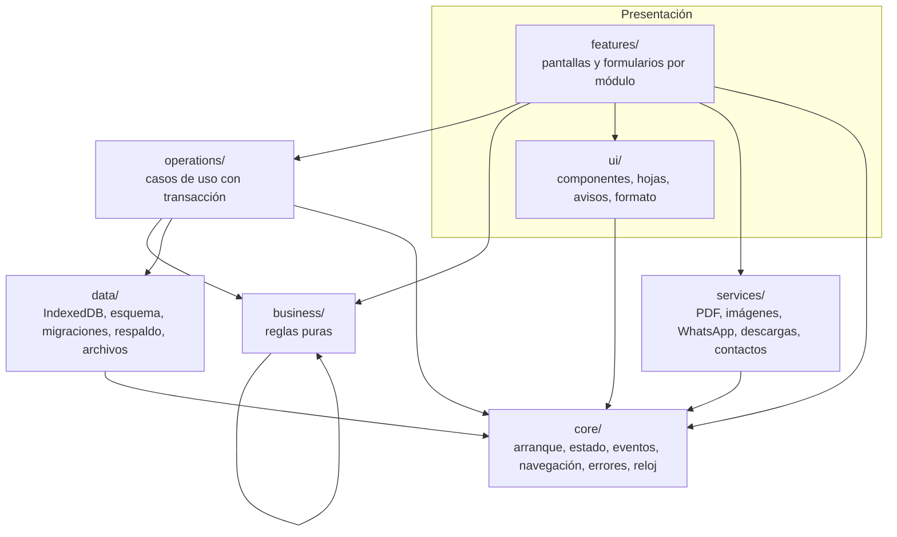
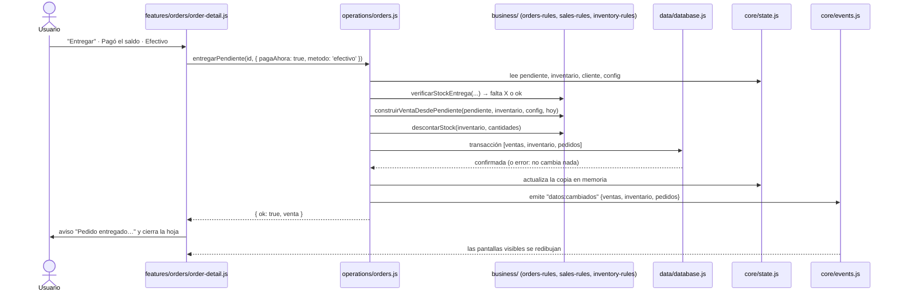

# Orisma 2.0 · Etapa 2 · Documento maestro de arquitectura

**Base:** auditoría de la Etapa 1 (`../etapa-1/`). Referencias `D4-xx` = hallazgos del Documento 4;
`RI-xx`, `RV-xx`… = reglas del Documento 2.

---

## 1. Decisiones de fondo

| # | Decisión | Por qué | Alternativa descartada |
|---|---|---|---|
| A1 | **JavaScript estándar con módulos ES, sin compilación ni framework.** | Se publica tal cual (GitHub Pages), funciona sin conexión, no hay dependencias que mantener, el dueño puede abrir cualquier archivo y leerlo. La app es de un solo usuario y de tamaño mediano: un framework no aporta lo suficiente para justificar su costo. | React/Vue/Svelte con Vite: exige `npm`, paso de compilación y actualizaciones de dependencias. |
| A2 | **IndexedDB como almacenamiento principal.** | Probado en esta etapa: transacciones que se deshacen completas, imágenes como archivos binarios, cuota de gigabytes en vez de ~5 MB (Pruebas §11). Corrige D4-10. | Seguir con `localStorage`: límite de 5 MB, sin transacciones, errores silenciosos. |
| A3 | **Las reglas comerciales son funciones puras**, separadas de la pantalla y del almacenamiento. Reciben todo lo que necesitan (incluida la fecha de hoy y la configuración) y devuelven un resultado. | Se pueden probar sin abrir la app y comparar con la versión original. Una sola fuente de verdad por cálculo (Documento 3 §9). | Cálculos dentro de las pantallas, como hoy. |
| A4 | **Capa de operaciones (casos de uso)** entre la pantalla y los datos: cada acción del negocio ("registrar venta", "entregar pedido") es una función que valida, calcula con las reglas, guarda todo en **una transacción** y avisa del cambio. | Hoy una operación guarda 2 o 3 colecciones por separado y puede quedar a medias (Documento 3 §3). | Que cada pantalla guarde directamente. |
| A5 | **Los datos se leen de una copia en memoria**, cargada al iniciar y actualizada después de cada transacción confirmada. | Las pantallas dibujan de forma síncrona y rápida, como hoy (Documento 4 §6). El volumen esperado cabe holgadamente en memoria. | Consultar IndexedDB en cada pantalla: más lento y todo se vuelve asíncrono. |
| A6 | **Los nombres de los campos de datos no cambian** (`clienteId`, `abonos`, `fiado`, `stock: ''`…). | Compatibilidad total con los datos actuales y con los respaldos ya descargados. La migración no transforma lo que no hace falta. | Renombrar al inglés o "limpiar" el modelo: obligaría a transformar todo y aumenta el riesgo. |
| A7 | **Las reglas contradictorias se conservan tal cual, con nombre propio**, hasta que el dueño decida (Documento 2 §15). Por ejemplo, las tres fórmulas del total de un pendiente (D4-02) serán tres funciones distintas, documentadas como provisionales. | Regla fundamental del proyecto: no cambiar cálculos sin autorización. Al estar aisladas, corregirlas después será cambiar un solo lugar. | Unificarlas ya. |
| A8 | **La app original no se toca.** Se conserva en `main` y en el commit `9300dfa`. Orisma 2.0 se construye en su rama hasta que la Etapa 10 la apruebe. | Regla 1 y 2 del documento maestro. | — |
| A9 | **El commit `1480bd7` (división en módulos) no se usa como base de código.** Esa división fue mecánica: conserva el estado global y las reglas mezcladas con la pantalla. Se mantiene en el historial como material de consulta y se reemplaza al crear la nueva estructura en la Etapa 4. | La arquitectura nueva es por capas, no por pantallas. Partir de ella obligaría a deshacer casi todo. | Construir sobre `1480bd7`. |
| A10 | **Librerías del PDF incluidas en el proyecto** (`assets/vendor/`), no descargadas de internet. | El PDF funcionará sin conexión (D4-12) y se elimina el riesgo de código externo sin verificar (D4-24). Mismas versiones que hoy: html2canvas 1.4.1 y jsPDF 2.5.1. | Seguir con el CDN. |
| A11 | **Sin servicios externos nuevos**: ni nube, ni analítica, ni sincronización. | Reglas 7, 8 y 9 del documento maestro. | — |

---

## 2. Capas



### 2.1 Responsabilidad de cada capa

| Capa | Hace | No hace nunca |
|---|---|---|
| `core/` | Arranca la app, guarda el estado en memoria, distribuye eventos, maneja la navegación y el botón atrás, captura errores, da la fecha de hoy. | Conocer reglas comerciales o pantallas concretas. |
| `data/` | Abre IndexedDB, define el esquema, ejecuta transacciones, migra versiones, importa desde `localStorage` (sin borrarlo), guarda imágenes, exporta y valida respaldos. | Calcular totales, saldos o stock. Tocar el HTML. |
| `business/` | Calcula: totales, descuentos, impuestos, pagos, saldos, reservas, costo promedio, caja, ganancia, folios. Valida reglas comerciales. | Leer o escribir datos. Usar el DOM. Llamar a la fecha del sistema (la recibe). Importar de otra capa. |
| `operations/` | Ejecuta una acción completa del negocio: lee de la memoria, valida y calcula con `business/`, escribe en una transacción, actualiza la memoria, emite el evento. | Dibujar pantallas, mostrar mensajes, abrir hojas. |
| `services/` | Habla con el navegador o con el exterior: genera PDF, reduce imágenes, abre WhatsApp, descarga y comparte archivos, importa contactos. | Reglas comerciales o guardar datos. |
| `features/` | Dibuja cada pantalla, recoge lo que escribe el usuario, llama a la operación correspondiente y muestra el resultado. | Calcular reglas por su cuenta o guardar directamente en la base. |
| `ui/` | Piezas visuales reutilizables: plantillas con escape automático, hojas y diálogos, avisos, selectores, filas, tarjetas, formato de dinero y fechas. | Conocer clientes, ventas o cualquier dato del negocio. |

### 2.2 Reglas de dependencia (obligatorias)

1. Una capa solo importa de las capas a las que apunta su flecha en el diagrama.
2. `business/` es **pura**: no importa nada fuera de `business/`.
3. Ningún archivo de `features/` importa de `data/`. Para escribir, se usa una operación.
4. Un módulo de `features/` no importa de otro módulo de `features/`. Si dos pantallas necesitan comunicarse, lo hacen con un evento o con la navegación.
5. No hay variables globales mutables fuera de `core/state.js`.

Estas reglas se verificarán automáticamente con `tools/check-architecture.js` (Etapa 4), que lee los `import` de
cada archivo y falla si alguno rompe la tabla.

---

## 3. Cómo se comunican los módulos

### 3.1 Flujo de una acción

Ejemplo: **entregar un pedido** (hoy `entregarPedido`, L1164).



### 3.2 Contrato de una operación

```js
// operations/orders.js
export async function entregarPendiente(id, opciones) → { ok: true, venta } | lanza ErrorDeNegocio / ErrorDeAlmacenamiento
```

- Recibe datos simples (ids y valores del formulario), nunca elementos del DOM.
- Todo lo que escribe va en **una sola transacción**. Si algo falla, no queda nada a medias.
- Solo actualiza la memoria **después** de que la transacción se confirma.
- Emite un único evento `datos:cambiados` con la lista de colecciones tocadas.

### 3.3 Contrato de una regla

```js
// business/orders-rules.js
export function construirVentaDesdePendiente(pendiente, { inventario, cliente, impuesto, hoy, nuevoId }) → venta
```

- Función pura: mismo resultado para la misma entrada; no modifica lo que recibe.
- La fecha (`hoy`) y los identificadores (`nuevoId`) se reciben como parámetros, para poder probarla con valores fijos.
- Cada función indica en un comentario la regla que implementa (`// RP-10`) y la línea de la versión original.

### 3.4 Eventos

Pocos eventos, con nombres fijos en `core/events.js`:

| Evento | Cuándo | Quién escucha |
|---|---|---|
| `datos:cambiados` | tras cada transacción confirmada; lleva las colecciones tocadas | la pantalla visible (se redibuja si usa alguna) y el encabezado |
| `ajustes:cambiados` | al guardar cualquier sección de ajustes | encabezado, formato de dinero |
| `navegacion:cambio` | al cambiar de pestaña o sub-vista | marco de la app |
| `app:error` | error no controlado | avisos |
| `app:actualizacion` | hay una versión nueva del service worker esperando | aviso "Nueva versión disponible" |

### 3.5 Registro de módulos (para crecer sin tocar lo existente)

Cada módulo de `features/` exporta una descripción:

```js
export default {
  id: 'clientes',
  titulo: 'Clientes',
  icono: 'clientes',
  orden: 10,
  buscador: 'Buscar cliente...',
  dibujar(contenedor, contexto) { … },   // pinta la pantalla
  accionPrincipal(contexto) { … },        // botón +
  usa: ['clientes', 'ventas'],            // colecciones que la redibujan
};
```

`src/app.js` tiene la lista de módulos. Agregar uno nuevo = crear su carpeta y añadir **una línea** a esa lista.
Las pestañas, el buscador, el botón + y el redibujado salen de la descripción.

---

## 4. Núcleo (`core/`)

| Archivo | Responsabilidad |
|---|---|
| `config.js` | Constantes de la app: versión, nombre y versión de la base, lista de colecciones, valores por defecto de los ajustes (`CONFIG_DEFAULTS` actual, sin cambios). |
| `state.js` | Copia en memoria de las colecciones y de los ajustes; estado de navegación (pestaña, sub-vistas, filtros, día y mes de caja). Solo `operations/` y el arranque escriben aquí. |
| `events.js` | Emisor de eventos (suscribirse, emitir, cancelar). |
| `navigation.js` | Ruta en la dirección (`#/ventas/pendientes`), pila de hojas abiertas sincronizada con el historial para que el **botón atrás** cierre la hoja en vez de salir de la app. |
| `errors.js` | Tipos de error (`ErrorDeValidacion`, `ErrorDeNegocio`, `ErrorDeAlmacenamiento`, `ErrorInesperado`), captura global (`error`, `unhandledrejection`), registro local de los últimos errores y traducción a un mensaje entendible. |
| `clock.js` | `hoy()` y `ahora()`. Un único lugar para la fecha: permite fijarla en pruebas. |

---

## 5. Datos (`data/`)

Se diseña en detalle en la Etapa 5. Esta etapa fija su forma:

| Archivo | Responsabilidad |
|---|---|
| `database.js` | Abrir la base `orisma`, crear almacenes, ejecutar transacciones (`transaccion(almacenes, fn)`), leer todo al iniciar, pedir almacenamiento persistente al navegador. |
| `schema.js` | Lista de almacenes y, para cada tipo de registro, sus campos y tipos (los del Documento 2 §1, sin renombrar). Lo usan la validación de respaldos y la migración. |
| `migrations.js` | Versión del esquema y los pasos para pasar de una versión a la siguiente. |
| `legacy-import.js` | Lee las 7 claves `cuentas_*` de `localStorage`, hace una copia de seguridad, valida, convierte y carga en IndexedDB. **No borra ni modifica `localStorage`** (Etapa 9). |
| `files.js` | Almacén de imágenes como archivos binarios; los registros guardan una referencia. Convierte a `data:` al exportar el respaldo. |
| `backup.js` | Exportar (formato v3, con imágenes incluidas), importar formatos v2 (actual) y v3, validar contra `schema.js`, respaldo automático antes de restaurar o migrar. |

Almacenes previstos (uno por colección actual): `clientes`, `inventario`, `ventas`, `gastos`, `movimientos`,
`pedidos`, `ajustes` (un solo registro), `archivos` (imágenes), `registro` (errores y migraciones).

**Ojo con el formato de las imágenes:** hoy los campos `foto`, `logo`, `fotoPerfil` y `firmaImg` guardan la imagen
en texto (`data:image/jpeg;base64,…`). Guardarlas aparte es la mejora con más impacto en espacio (D4-10).
Cómo se referencian sin romper la compatibilidad con los respaldos actuales se define en la Etapa 5.

---

## 6. Reglas comerciales (`business/`)

| Archivo | Contiene | Reglas |
|---|---|---|
| `numbers.js` | Conversión segura a número (`Number(x) || 0`), sumas de listas. | base de todas |
| `dates.js` | Mes de una fecha, mes anterior, comparaciones; sin formato visual. | RG-03, RP-01 |
| `inventory-rules.js` | ¿Tiene control de stock?, poco stock, reservas, disponible, costo promedio, precio↔ganancia, descontar y devolver stock, historial. | RI-01…RI-17 |
| `sales-rules.js` | Totales de la venta (suma, descuento, impuesto, total), costo y ganancia, prenda a medida, pagos según medio. | RV-01…RV-14 |
| `payments.js` | Abonado, saldo, deuda por cliente, total por cobrar, límites de abonos, liquidación. | RC-01…RC-06 |
| `orders-rules.js` | Estado por fecha, orden de la lista, las tres fórmulas actuales del total (provisionales, A7), abonos, entrega (venta resultante), cancelación (devoluciones), comprobante. | RP-01…RP-17 |
| `invoicing.js` | Asignar folio, número de comprobante, datos del documento (descripción e imagen de cada ítem, sello pagada). | RF-01…RF-08 |
| `accounting.js` | Caja (día y mes), flujo, ganancia por período, top de productos. | RK, RL, RR |
| `validation.js` | Validaciones comerciales: campos obligatorios, montos, stock suficiente, materiales. Devuelven la lista de problemas, no muestran nada. | RG-06, RI-16, RI-17, RV-01 |

Las fórmulas de anulación (RA-01…RA-03) quedan en `sales-rules.js` (dinero) e `inventory-rules.js` (stock), y la
operación `anularVenta` las combina. Las de gastos (RG-07…RG-09) quedan en `validation.js` e `inventory-rules.js`.
Asignación completa regla por regla: `03-trazabilidad.md`.

---

## 7. Operaciones (`operations/`)

| Archivo | Operaciones |
|---|---|
| `clients.js` | crear, editar, eliminar cliente |
| `products.js` | crear, editar (con ajuste de stock), eliminar producto |
| `purchases.js` | registrar compra (una sola, usada desde el producto y desde Gastos; hoy hay dos con resultados distintos, D4-01; mientras no se autorice, la del producto conserva su comportamiento) |
| `sales.js` | registrar venta, anular venta |
| `orders.js` | crear y editar pendiente, abonar, entregar, cancelar, generar comprobante |
| `credits.js` | abonar a una venta, liquidar deuda de un cliente |
| `invoices.js` | generar factura, editar factura |
| `expenses.js` | crear, editar, eliminar gasto |
| `settings.js` | guardar cada sección de ajustes |
| `backup.js` | descargar respaldo, restaurar respaldo |

---

## 8. Servicios (`services/`)

| Archivo | Responsabilidad | Hoy |
|---|---|---|
| `pdf.js` | Convertir el documento HTML de la factura o el comprobante en PDF (A4, varias páginas). Carga las librerías locales solo cuando se piden. | L3444–3514 |
| `images.js` | Leer un archivo de imagen, reducirlo (300 o 400 px, JPEG 85 %), rechazar más de 15 MB, validar que sea imagen. | L3559 |
| `export.js` | Descargar un archivo o compartirlo con el sistema del teléfono (Web Share). | L3456, L3807 |
| `whatsapp.js` | Normalizar el teléfono (indicativo 57) y abrir el chat con el texto. Los textos salen de `business/` o de cada módulo. | L3628 |
| `contacts.js` | Importar un contacto del teléfono si el navegador lo permite. | L1924, L1959 |

---

## 9. Interfaz (`features/` y `ui/`)

El sistema visual y los prototipos se definen en la **Etapa 3**. La arquitectura fija:

- **Plantillas con escape automático** (`ui/html.js`): toda inserción de datos pasa por una función que escapa
  por defecto. Insertar HTML sin escapar exige marcarlo explícitamente. Las imágenes solo aceptan `data:image/…`
  y `blob:`. Corrige D4-11.
- **Hojas y diálogos** (`ui/overlays/`): una pila única gestionada con `core/navigation.js`; confirmación
  uniforme para eliminar (D4-13); foco y cierre con Escape.
- **Avisos** (`ui/notifications/`): reemplazan los 24 `alert()`; tipos éxito, aviso, error y error grave
  (este último no se cierra solo, por ejemplo "No se pudo guardar").
- **Marco adaptable** (`ui/layouts/app-shell.js`): pestañas abajo en el teléfono y barra lateral en computador (D4-30).
- **Formato** (`ui/format.js`): dinero (RG-02), fechas, folio `F-0007` (RG-04). Sin reglas de negocio.

Cada módulo de `features/` tiene una carpeta con su pantalla principal y sus formularios. Archivos de
**máximo ~300 líneas**; si un formulario crece más (el asistente de venta hoy tiene 585), se divide en partes.

---

## 10. Errores

| Tipo | Ejemplo | Qué ve el usuario | Qué pasa con los datos |
|---|---|---|---|
| `ErrorDeValidacion` | falta el nombre, monto 0 | mensaje junto al campo | nada se guarda |
| `ErrorDeNegocio` | no hay stock suficiente | aviso con la explicación | nada se guarda |
| `ErrorDeAlmacenamiento` | disco lleno, base bloqueada | aviso grave que no se cierra solo, con opción de descargar respaldo | la transacción se deshace completa |
| `ErrorInesperado` | fallo de programación | aviso "Algo salió mal" | si ocurre dentro de una operación, se deshace; se registra para diagnóstico |

Ningún error se queda solo en la consola (corrige el comportamiento de `save()`, D4-10).

---

## 11. Seguridad (base para la Etapa 8)

| Medida | Corrige |
|---|---|
| Escape automático en plantillas, imágenes solo `data:image`/`blob:` | D4-11 |
| Validación completa de respaldos contra el esquema antes de restaurar | D4-11, D4-14 |
| Política de seguridad de contenido en `index.html` (`script-src 'self'`, sin código en línea) | D4-11, D4-24 |
| Librerías locales | D4-24 |
| `noopener` al abrir enlaces externos | D4-26 |
| Respaldo automático antes de restaurar o migrar | D4-14 |
| Bloqueo opcional con PIN (Etapa 8): protege del uso casual, **no** cifra ni protege frente a quien tenga el teléfono desbloqueado o las herramientas de desarrollo | — |

---

## 12. Funcionamiento sin conexión y versiones

- `sw.js` precarga todos los archivos de la app, incluidas las librerías del PDF.
- Las navegaciones sin conexión reciben `index.html`; **los demás archivos nunca** (corrige el efecto de T15).
- El nombre de la caché sale de la versión de la app (`core/config.js`). La lista de archivos a precargar la
  genera `tools/precache.js`; una prueba falla si la lista no coincide con los archivos reales.
- Cuando hay versión nueva, la app avisa y se actualiza al aceptar (no a mitad de una operación).

---

## 13. Pruebas

| Tipo | Herramienta | Qué cubre |
|---|---|---|
| Reglas | `node --test` (incluido en Node, sin dependencias) | cada función de `business/` con casos sacados de la versión original |
| Comparativas | Playwright (solo en desarrollo, no se publica) | mismas operaciones en la app original y en Orisma 2.0 con los mismos datos; se comparan resultados guardados y cifras mostradas |
| Arquitectura | `tools/check-architecture.js` | reglas de dependencia de §2.2 |
| Sin conexión | Playwright | la app abre, opera y genera PDF sin red |

Las pruebas de la Etapa 1 (`../etapa-1/pruebas/`) se reutilizan como base de las comparativas.

---

## 14. Convenciones

| Tema | Convención |
|---|---|
| Idioma | Términos del negocio **en español**, igual que los datos y los documentos (`registrarVenta`, `saldoVenta`, `clienteId`). Infraestructura técnica con nombres estándar en inglés (`database`, `events`, `navigation`). Comentarios en español. |
| Archivos y carpetas | minúsculas con guiones: `sales-rules.js`, `order-detail.js`. |
| Funciones | verbo + objeto en camelCase: `calcularTotalVenta`, `registrarAbono`. Las que solo calculan empiezan por sustantivo o `calcular`; las que cambian datos, por verbo de acción. |
| Constantes | MAYÚSCULAS: `CONFIG_DEFAULTS`, `COLECCIONES`. |
| Exportaciones | con nombre (`export function`); `export default` solo para la descripción de cada módulo de `features/`. |
| Tamaño | archivos de ~300 líneas como máximo, funciones de ~50. |
| Estilo | 2 espacios, punto y coma, comillas simples, `const` por defecto. |
| Documentación | cada función de `business/` con comentario JSDoc de entradas y salida, y la regla que implementa (`RV-04`). |
| CSS | variables de diseño en `styles/variables.css`; clases por componente; sin estilos en línea. |

---

## 15. Extensibilidad

| Quiero… | Toco… |
|---|---|
| Agregar un módulo nuevo | crear `features/<modulo>/`, sus reglas en `business/`, sus operaciones en `operations/`, una línea en `src/app.js` |
| Cambiar una regla autorizada | una función de `business/` y su prueba |
| Agregar un campo a un registro | `data/schema.js`, un paso en `data/migrations.js`, el formulario del módulo |
| Cambiar el aspecto | `styles/` y `ui/`; ninguna regla |
| Agregar un medio de pago | `business/sales-rules.js`, `business/accounting.js` (caja) y el selector en `ui/` |
