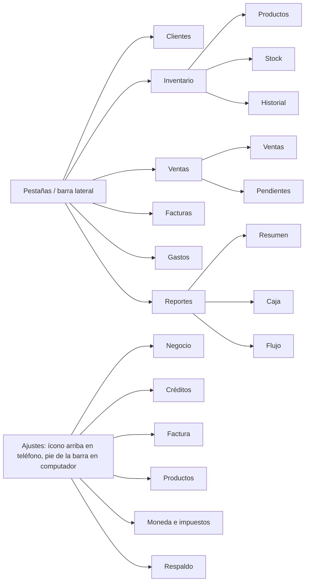

# Orisma 2.0 · Etapa 3 · Pantallas, prototipos y flujos

**Prototipo:** `prototipo/index.html`. Se abre en un navegador (hay que servir la carpeta, por ejemplo
`python3 -m http.server` dentro de `prototipo/` y abrir `http://localhost:8000/?p=ventas`).
El selector de arriba a la derecha cambia de pantalla y de tema. Todos los datos son **ficticios** y nada se guarda.

## 1. Pantallas prototipadas

| Pantalla (`?p=`) | Contenido | Funcionalidades (Etapa 1, Doc. 1) | Captura |
|---|---|---|---|
| `clientes` | lista con deuda por cliente | 1.1, 1.2 | `movil-clientes.png` |
| `formulario` | nuevo cliente con error de validación | 1.3, 1.5 | `movil-formulario.png` |
| `confirmar` | confirmación de eliminar con consecuencias | 1.7 | `movil-confirmar.png` |
| `vacio` | estado vacío | 1.1 | `movil-vacio.png` |
| `inventario` | productos, poco stock, categorías, reservas, ganancia | 2.1.1–2.1.4 | `movil-inventario.png`, `escritorio-inventario.png`, `movil-oscuro-inventario.png` |
| `ventas` | lista agrupada por fecha; tabla en computador | 3.1.1–3.1.3 | `movil-ventas.png`, `escritorio-ventas.png`, `movil-oscuro-ventas.png` |
| `nueva-venta` | asistente paso 2: carrito, servicio libre, prenda a medida, descuento, total editable, tipo de registro, pago a crédito con abono inicial, totales, ganancia | 3.2.3–3.2.13, 3.2.17 | `movil-nueva-venta.png`, `escritorio-nueva-venta.png`, `movil-oscuro-nueva-venta.png` |
| `pendientes` | pedidos (vencidos/hoy/próximos), encargos, apartados | 3.3.1 | `movil-pendientes.png` |
| `pedido` | detalle de pedido: total, anticipo, saldo, ganancia, abonos, acciones | 3.3.6, 3.3.7, 3.3.9–3.3.11, 3.3.13 | `movil-pedido.png`, `escritorio-pedido.png` |
| `facturas` | lista con estado de pago y aviso de ventas sin factura | 4.1, 4.3 | `movil-facturas.png` |
| `factura` | documento de factura con imprimir, compartir PDF, editar, anular | 4.5–4.9 | `movil-factura.png` |
| `gastos` | lista con compras y devoluciones | 5.1 | `movil-gastos.png` |
| `reportes` | ganancia del período, movimiento, más vendidos | 7.1–7.5 | `movil-reportes.png`, `escritorio-reportes.png`, `movil-oscuro-reportes.png` |
| `caja` | cierre diario: ingresos por medio, abonos de créditos | 7.6, 7.7 | `movil-caja.png` |
| `ajustes` | menú de secciones con resumen | 8.1 | `movil-ajustes.png` |
| `avisos` | aviso normal con acción y aviso grave de almacenamiento | 9.1 (D4-10) | `movil-avisos.png` |

Las demás pantallas (stock, historial, flujo, apartado, encargo, formularios de producto, compra, gasto,
pendiente, servicio libre, prenda a medida, créditos, secciones de ajustes, respaldo) se construyen en la Etapa 7
con los mismos componentes; no tienen patrones nuevos que decidir ahora.

## 2. Flujos principales (sin cambios de proceso)

### 2.1 Registrar una venta
| Paso | Hoy | Orisma 2.0 |
|---|---|---|
| 1 | "+" en Ventas | botón "Nueva venta" |
| 2 | elegir cliente | igual (paso 1 de 2) |
| 3 | agregar productos, servicio libre o prenda a medida; cantidades y precios | igual; el cliente elegido queda visible arriba con "Cambiar" (equivale al "Atrás" actual y conserva el carrito) |
| 4 | descuento %, total editable, impuesto | igual |
| 5 | elegir Venta / Pedido / Encargo / Apartado | igual |
| 6 | forma de pago (efectivo, tarjeta, crédito + abono inicial, mixto) | igual |
| 7 | "Registrar venta" → pantalla de confirmación → "Confirmar cobro" | "Revisar y cobrar" → la **misma** confirmación → "Confirmar cobro" |
| 8 | "Venta registrada" con ganancia y opción de factura | igual |

### 2.2 Entregar un pedido
| Paso | Hoy | Orisma 2.0 |
|---|---|---|
| 1 | Ventas › Pendientes › tocar pedido | igual |
| 2 | "Marcar entregado" → elegir "Pagó el saldo" (efectivo/tarjeta) o "Queda a crédito" → "Entregar" | igual; el botón queda fijo al pie de la hoja |
| 3 | `alert` "Pedido entregado y registrado como venta…" | aviso con el mismo texto y acción "Ver venta" |

### 2.3 Abonar a una deuda
Clientes › cliente › venta a crédito → abono (monto, fecha, nota, medio). Sin cambios; el formulario usa los
nuevos campos y el error aparece junto al monto.

### 2.4 Cerrar la caja
Reportes › Caja › Diario/Mensual › día o mes. Sin cambios.

## 3. Navegación

Cada vista tiene dirección propia (`#/ventas/pendientes`), así que el botón atrás y recargar la página
devuelven al mismo lugar.
